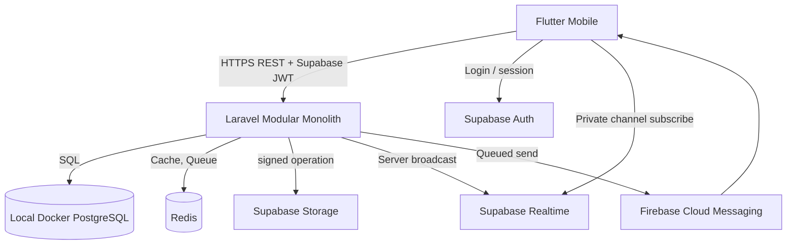

# System Architecture — ADR-001

## Topology

## Ownership

Phase 2A decision: Supabase Cloud owns Auth only in the current implementation scope; domain data stays in local Docker PostgreSQL and Redis stays local. No cloud domain-data migration is authorized. See [approved decisions](phase-2a-decisions.md). Realtime/Storage/FCM edges above describe deferred capabilities.
| Component | Owns | Must not own |
|---|---|---|
| Flutter | UI, client state, accessible UX, calling API, Supabase Auth/Realtime subscriptions | business authorization, secret keys, direct writes to business tables |
| Laravel | validation, domain rules, API, matching, invitations, signed material download, message persistence, audit | user password store duplicating Supabase Auth |
| Supabase Auth | session and identity | university enrollment verification unless custom verified workflow added |
| Postgres | durable transactional source of truth | queue processing |
| Supabase Realtime | authorized client event delivery | permanent message storage |
| Storage | material objects | blanket public buckets for private files |
| Redis | ephemeral caching, background queue, rate-limit counters | identity/source-of-truth |
| FCM | push delivery | message history |

## Backend boundaries (Laravel)
`Identity`, `AcademicProfiles`, `Matching`, `Invitations`, `Materials`, `Messaging` (P1), `Workspace` (P1/P2), `Moderation`, `Notifications`, `Shared`.
Controllers -> Form Requests -> Domain Services -> Eloquent/Repositories; Policies and observers/events; jobs after committed transactions. Maintain `api/v1` versioned prefix.

## Flutter feature folders
Phase 2E.1 uses the existing SDK/secure storage, a native HTTP transport, typed DTO/repository and ChangeNotifier state, with no new dependencies. Riverpod/go_router/Dio below remain suggestions. See [implemented Flutter client architecture](flutter-client.md) and [validation status](phase-2e1-status.md).

`core/{network,auth,theme,router,error}`, `features/{onboarding,academic_profile,discovery,matching,invitations,materials,messaging,workspace,settings}`. Feature-local `data/domain/presentation` when genuinely useful; avoid architecture ceremony on tiny features. Suggested Riverpod + go_router + Dio, subject to team confirmation.

## Critical flows
1. **Signup**: Flutter -> Supabase Auth -> Laravel `GET /me` with JWT -> provision `users` UUID -> student domain verification -> onboarding. Email-domain match alone does not prove enrollment; optionally campus SSO or staff review.
2. **Matching**: Flutter -> Laravel `GET /matches/recommendations` -> hard filters (eligible, academic intent, role/course) -> weighted score (skill/goal/availability) -> stable sorting. Do not use MBTI.
3. **Invitation**: sender -> Laravel post -> transaction+unique constraint -> event+queued FCM. Recipient -> accept -> relation established.
4. **Chat P1**: authenticated sender -> Laravel -> permission check -> DB commit -> private broadcast event -> recipients subscribe through policy-controlled Supabase Realtime; offline recipients receive FCM. No direct client broadcast of trusted message events.
5. **Materials P0**: Laravel validates student/material access -> prepares authorized ZIP asynchronously -> short-lived signed URL -> audit/expiration/retention cleanup.

## Scalability
Start one API + one worker + managed Postgres + managed realtime. Add caching only to safe reads; invalidate on profile/match changes. Use cursor pagination, indexes, rate limits, background workers, and request-id based logs. Do not optimize prematurely or add microservices.
