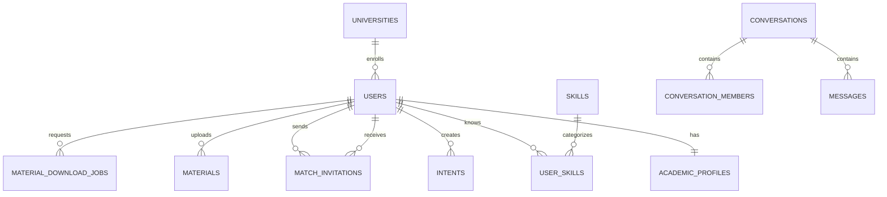

# Domain data model v1

**Authority**: Laravel migrations for application `public` tables. Supabase `auth.users` managed by Supabase. Application `users.id` is UUID linked in service logic to `auth.users.id` (avoid coupling all local tests to Supabase-managed schema). All timestamps UTC; user UI in Asia/Jakarta or user-selected zone.

| Table | Key columns / constraints | Notes |
|---|---|---|
| users | id UUID PK, display_name, university_id FK, status, created_at | same UUID as Supabase Auth UID |
| universities | id UUID PK, name, verified_domains jsonb | domain allowlist is weak verification |
| student_verifications | id, user_id FK, method, status, reviewed_at | verified enrollment workflow |
| academic_profiles | user_id PK/FK, program, semester, bio, mbti_badge nullable, visibility | MBTI never matching input |
| courses | id, university_id nullable, code, name, UNIQUE(university_id,code) | course catalog |
| skills | id, normalized_name unique | canonical skill taxonomy |
| user_skills | user_id, skill_id, level, PK(user_id,skill_id) | validation bounds |
| user_courses | user_id, course_id, PK(user_id,course_id) | enrolled/interested distinction later |
| intents | id, user_id, type study/competition, course_id nullable, goal, active | intent-based search |
| availability_slots | id, user_id, weekday, start_minute, end_minute, timezone | reject overlaps/invalid range |
| competition_roles | id, slug unique, name | roles sought/held |
| intent_roles | intent_id, role_id, required boolean | separate preferences |
| match_invitations | id, sender_id, recipient_id, intent_id, status, created_at, responded_at | prevent duplicates, enforce direction |
| connections | id, user_low_id, user_high_id, created_at, UNIQUE(user_low_id,user_high_id) | normalized pair |
| materials | id, owner_id, course_id, storage_path, title, visibility, rights_status | storage private |
| material_download_jobs | id, requester_id, status, archive_path, expires_at, error | retention policy |
| conversations (P1) | id, connection_id nullable, created_at | membership checked |
| conversation_members (P1) | conversation_id, user_id, PK(conversation_id,user_id) | realtime policy join |
| messages (P1) | id, conversation_id, sender_id, body, created_at | server writes only |
| device_tokens (P1) | id, user_id, token_hash unique, token_encrypted, platform, last_seen_at | rotate/revoke on logout |
| workspaces (P1) | id, title, owner_id, source_intent_id | minimal collaboration |
| workspace_members (P1) | workspace_id, user_id, role | access policy |
| audit_events | id, actor_id, action, resource_type, resource_id, request_id, created_at | no secrets or message bodies |
| reports | id, reporter_id, target_type, target_id, reason, status | moderation |

## Relationship sketch

## Required indexes
`intents(type,active,course_id)`, `availability_slots(user_id,weekday)`, `match_invitations(recipient_id,status,created_at)`, `messages(conversation_id,created_at,id)` in P1. Use DB constraints for enumerations/IDs, self-invite prohibition and canonical connection pair ordering. Optional text search later.

## Access boundaries
Use RLS for any mobile-accessible Supabase resources, especially `realtime.messages` policies and `storage.objects`; API-only tables should be inaccessible via public Data API grants, with server access through secure Postgres role. Do not assume Postgres connection using privileged role is protected by user RLS: Laravel policies are mandatory.
